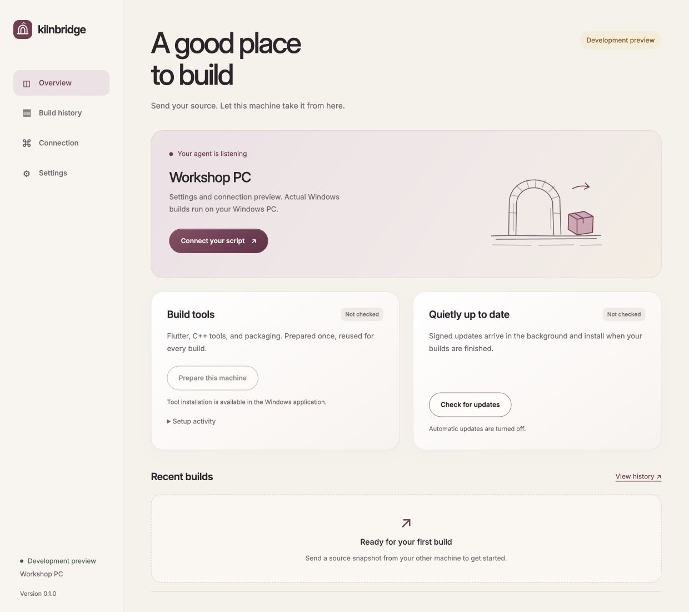

# Kilnbridge

**Turn your Windows PC into a build machine for your local release script.**

Kilnbridge receives a ZIP of your local source, runs your Windows build recipe, and
uploads selected files and directories directly to MinIO or compatible S3 storage.
No GitHub account, repository access, or manual package setup is needed on the worker.

[Download for Windows](https://github.com/Jourloy/kilnbridge/releases/latest/download/kilnbridge-windows-amd64.exe) ·
[All releases and sender CLIs](https://github.com/Jourloy/kilnbridge/releases) ·
[API reference](docs/api.md)



## What it does

- One Windows EXE with a settings window and a persistent background worker in the system tray.
- Start at sign-in, pause submissions, show/copy/rotate the access key, and inspect logs.
- Receive local source snapshots over pinned HTTPS, including uncommitted changes when explicitly requested.
- Prepare Flutter, C++ Build Tools, Windows SDK, portable Git, and Inno Setup.
- Run project preparation scripts, restore locked dependencies, generate code, test, and build Windows x64.
- Publish installers, archives, CLI executables, libraries, and test reports, with SHA-256 checksums and a release manifest.
- Retry a failed upload without compiling again.
- Download publisher-signed GitHub updates in the background, install while idle, and roll back if the new worker fails to start.

Recipes build **Flutter, Tauri, Electron, .NET, or custom projects for Windows x64**.
One agent can process different recipes in the same queue. Android can continue building on
your development machine with your existing signing setup; the example below runs
both from one script. Native Windows ARM64 builds are not implemented.

## 1. Prepare the Windows PC

1. Download and open `kilnbridge-windows-amd64.exe` on Windows 10/11 x64. It copies itself
   to `%LOCALAPPDATA%\Kilnbridge\app\kilnbridge.exe` and adds a Start menu shortcut.
2. Click **Prepare this machine**. The first setup downloads several GB and may ask for
   administrator approval to install Microsoft C++ Build Tools. Allow at least 20 GB
   of free space for tools, caches, and build output. A requested restart must be
   completed before continuing setup.
3. In **Settings**, enable **Start with Windows** if desired. It starts at sign-in;
   this is a user application, not a system service. Closing settings keeps it running.
4. In **Connection**, choose a reachable LAN or VPN address and copy the connection
   settings to your development machine's `.env` file.
5. Allow inbound TCP **8743** on your private network in Windows Firewall. Keep the PC
   awake and connected while building. No router port forwarding is needed on a LAN.

Closing settings leaves the Kilnbridge icon in the system tray near the clock.
Click the icon to reopen settings, or right-click for **Open Kilnbridge** and
**Stop background agent**. Opening again restores an existing settings window.
Stopping is available after source uploads, tool setup, and accepted builds finish;
the icon disappears when the worker exits. The tray is also available at sign-in
when **Start with Windows** is enabled.

The settings window uses Windows WebView2. If it is unavailable, settings open in the
system browser; the worker can still run. Kilnbridge itself needs no Go, Node, Python,
Docker, or separately installed language runtime. Build SDKs are real dependencies:
the app manages their setup rather than embedding gigabytes of compilers into its EXE.

Only send projects you trust. A build executes code with your Windows user's access.
Use a private network or VPN and protect the agent key. See [Security](SECURITY.md).

## 2. Connect your release script

Download the sender binary for your development machine from the same release:

| Machine | Asset |
| --- | --- |
| Apple Silicon Mac | `kilnbridge-darwin-arm64` |
| Intel Mac | `kilnbridge-darwin-amd64` |
| Linux x64 | `kilnbridge-linux-amd64` |
| Linux ARM64 | `kilnbridge-linux-arm64` |
| Windows x64 | `kilnbridge-windows-amd64.exe` |

On macOS/Linux, make it executable and optionally rename it to `kilnbridge`:

```sh
chmod +x kilnbridge-darwin-arm64
mv kilnbridge-darwin-arm64 kilnbridge
cp examples/agent.env.example agent.env
```

Fill `agent.env` with the connection values from the Windows app, your API URL, and
MinIO credentials. The bucket must already exist and the endpoint must use HTTPS.
Credentials should permit uploads to the selected prefix, including multipart uploads.
Your existing `MINIO_ACCESS_KEY_ID`, `MINIO_SECRET_ACCESS_KEY`, `MINIO_REGION`,
`MINIO_ENDPOINT`, `MINIO_BUCKET`, and `API_URL` names are supported.

Copy [the Flutter recipe](examples/flutter-windows.json), set its `project` name, then run:

```sh
./kilnbridge submit \
  --source /path/to/flutter-app \
  --recipe examples/flutter-windows.json \
  --env agent.env
```

`--source` is an existing local Git working directory. The sender uses local Git to
identify files and the source commit; it never fetches or pushes. The worker receives
the archive and never needs access to your repository. Version and build number come
from the project's `pubspec.yaml` (`version: 1.2.3+45`). Commit `pubspec.lock` so the
worker can use `flutter pub get --enforce-lockfile`.

Use `--allow-dirty` to include uncommitted local changes and record `sourceDirty: true`.
Without it, dirty source is rejected. Ignored files, caches, `.env` files, and common
signing-key formats are excluded. Use exact `snapshotIncludes` paths only for necessary
source fixtures that would otherwise be filtered. Symlinks and submodules are not
supported by the snapshot sender. Keep files unchanged while it creates the snapshot.

The command prints a job ID and streams logs until upload finishes. `--detach` returns
after acceptance. Closing the sender does not cancel an accepted job:

```sh
./kilnbridge status --job YOUR_JOB_UUID --env agent.env
./kilnbridge wait --job YOUR_JOB_UUID --env agent.env
./kilnbridge cancel --job YOUR_JOB_UUID --env agent.env
./kilnbridge retry-upload --job YOUR_JOB_UUID --env agent.env
```

Dotenv values are literal; they are not executed or expanded. Values in `--env` override
the process environment. Never commit the populated file.

## Android locally, Windows remotely

For a Flutter project that already has an Android release script, use
[the combined wrapper](examples/release-both.sh). It submits Windows first, runs your
existing Android script, waits for both, and fails if either side fails. Each side
uploads its own candidate and platform manifest; it does not promote a release.

For 0trace0, [the included recipe](examples/0trace0-windows.json) mirrors the project's
Windows preparation scripts, selected Windows tests, code generation, and Inno Setup
installer. It explicitly includes the committed TLS test fixtures. Run the wrapper
with the mobile directory as the source:

```sh
KILNBRIDGE_BIN=/path/to/kilnbridge \
  ./examples/release-both.sh \
  /path/to/0trace0/mobile \
  ./examples/0trace0-windows.json \
  /path/to/0trace0/mobile/scripts/android/local_release.env \
  /path/to/0trace0/mobile/scripts/android/local_release.sh
```

Add the three `KILNBRIDGE_*` connection values to the same local release `.env` first.
Android signing keys stay on the development machine. The Windows worker uploads to:

```text
s3://BUCKET/PREFIX/JOB_UUID/
  my-app-1.2.3-windows-x64.zip
  my-app-1.2.3-windows-x64-setup.exe   # when installerScript is configured
  SHA256SUMS.txt
  manifest.json
```

`PREFIX` defaults to `release-candidates`. The Windows manifest records
`platform: "windows"`, `platforms: {"windows":"success","android":"skipped"}`, source
commit, archive hash, version, build number, test status, and artifact hashes. Skipped
tests are recorded as `skipped`, never as a successful test run.

## Recipes

Choose [Flutter](examples/flutter-windows.json), [Tauri](examples/tauri-windows.json),
[Electron](examples/electron-windows.json), [.NET](examples/dotnet-windows.json), or
[custom commands](examples/custom-windows.json). Use updated sender and agent binaries
for non-Flutter recipes and explicit artifact lists. See [recipe setup and commands](docs/recipes.md) for tool
requirements, examples, output packaging, and custom tests.

| Field | Purpose |
| --- | --- |
| `recipe` | `flutter` (default), `tauri`, `electron`, `dotnet`, or `custom` |
| `project` | Filename-safe release name |
| `workDir` | Project directory inside the ZIP; default `.` |
| `flutterVersion` | Exact stable version; default `3.41.6` |
| `version`, `buildNumber` | Required for non-Flutter; Flutter infers missing values from `pubspec.yaml` |
| `apiUrl` | Flutter `API_URL` define; overridden by `API_URL` in the environment |
| `prepareScripts` | Project-relative `.ps1` files, executed in order before dependency restore |
| `skipCodegen` | Set `true` for projects without `build_runner`; default `false` |
| `testPaths` | Selected project-relative tests; omitted means `flutter test` |
| `skipTests` | Explicitly skip tests and mark the manifest accordingly; default `false` |
| `installerScript` | Optional project-relative Inno `.iss`; receives `MyAppVersion` |
| `commands` | Custom recipe executable/argument objects, run in order |
| `testCommands` | Non-Flutter test commands; overrides preset tests |
| `outputDir` | Non-Flutter build output directory; packaged as ZIP when `artifacts` is omitted |
| `artifacts` | Optional list of 1–64 exact files/directories relative to `workDir`, published with their paths and original bytes |
| `snapshotIncludes` | Exact source-relative file exceptions to the sender's default filter |

Paths use `/` and must stay inside the source tree. Scripts run with the selected
project as their working directory. MinIO credentials are passed to the agent, not as
command-line arguments or environment variables to build processes. Because build code
runs as the same user, this is not a credential isolation boundary.

Use [the mixed-artifacts example](examples/custom-artifacts-windows.json) to publish
an installer, archive, CLI, library directory, and reports in one job. Explicit
`artifacts` replaces automatic ZIP packaging for every recipe; directories expand
recursively. Missing paths, empty selected directories, links, overlapping paths,
and reserved root metadata names fail the job. Custom recipes with `artifacts` do
not need `outputDir`. Reports are collected only after successful tests and builds.
See [artifact selection](docs/recipes.md#artifacts) for details and Flutter installers.

## Background updates

Automatic updates are enabled by default. Kilnbridge checks the latest stable GitHub
release shortly after startup and then every six hours. It verifies an Ed25519 signature,
version, SHA-256, and file size before staging an EXE. Installation waits until the
queue is empty, tool setup is finished, and the settings window is closed. No update
prompt or terminal window appears. A copied helper replaces the idle worker and rolls
back if the new process does not acknowledge healthy startup within a minute.

The signing public key is compiled into the application. Changing the GitHub repository
in settings does not trust a new signing key. Maintainers and fork authors should read
[the release guide](docs/releasing.md). macOS/Linux sender binaries are updated manually.

## Data and troubleshooting

All Windows app data is under `%LOCALAPPDATA%\Kilnbridge`:

| Path | Contents |
| --- | --- |
| `app/` | Installed EXE |
| `config.json` | Non-secret settings |
| `secrets.bin` | DPAPI-encrypted agent/admin keys and TLS private key |
| `jobs/` | Job metadata, logs, encrypted job settings, temporary sources, and artifacts |
| `tools/` | Reused toolchains, downloads, and package cache |
| `updates/` | Verified staged releases and update diagnostics |

- **No window after double-clicking a downloaded EXE:** open the installed app
  directly with Win+R: `%LOCALAPPDATA%\Kilnbridge\app\kilnbridge.exe`.
  Earlier launchers could leave the settings window hidden while the worker was
  running. Download version 0.1.1 or later; existing settings and build data can
  be kept.
- **Cannot connect:** check the selected address, private-network firewall rule, VPN,
  agent key, and certificate fingerprint. An expired or mismatched certificate is rejected
  before sending credentials. A new access key does not change the certificate pin.
- **Cannot see the tray icon:** check the hidden-icons arrow near the Windows clock.
  Windows may put new icons there; move Kilnbridge into the visible notification area
  in taskbar settings. Clicking its icon opens settings without restarting the worker.
- **Setup needs attention:** read **Setup activity**, complete any Windows installer
  prompt/restart, then retry. First setup and dependency restore require internet access.
- **Build failed:** inspect Build history. Fix the project and submit a new snapshot.
- **Upload failed:** correct connectivity/permissions and use **Retry upload**. If the
  saved credentials themselves need changing, submit a new job with corrected settings.
- **Need another port:** stop the idle agent in Settings, edit `listen` in `config.json`,
  and reopen the app. Update the firewall rule and sender address accordingly.
- **Uninstall:** turn off startup, save, stop the idle agent, close settings, remove the
  data directory and the Kilnbridge Start menu shortcut. Shared Microsoft Build Tools
  remain installed; remove them with Visual Studio Installer if no longer needed.

History retention defaults to seven days and is configurable from one to ninety days.
Successful uploads remove source files and per-job credentials immediately. Failed
uploads retain encrypted credentials until retry or retention cleanup. Large tool caches
are retained for reuse. The worker does not keep Windows awake automatically.

## Develop

Use the Go version declared in `go.mod`:

```sh
go test -race ./...
go vet ./...
go build -o dist/kilnbridge ./cmd/kilnbridge
GOOS=windows GOARCH=amd64 CGO_ENABLED=0 go build \
  -trimpath -ldflags='-s -w -H windowsgui' \
  -o dist/kilnbridge-windows-amd64.exe ./cmd/kilnbridge
```

Run `go run ./cmd/kilnbridge` for settings, or `go run ./cmd/kilnbridge serve --data
/path/to/disposable-data` for a foreground development worker. Stop the foreground
worker with Ctrl+C. Non-Windows agent mode is a development preview and rejects real
Windows build jobs.

CI tests Linux and Windows, launches the packaged Windows background process, parses
the PowerShell scripts, and performs a real Flutter Windows build. To run the expensive
toolchain test locally on Windows, set `KILNBRIDGE_SMOKE_TOOLS` to an absolute directory
and run `go test ./internal/build -run TestWindowsFlutterSmoke -v -timeout 40m`.

See [Contributing](CONTRIBUTING.md), [Architecture](docs/architecture.md), and
[Design](docs/design.md). Kilnbridge is [MIT licensed](LICENSE); bundled Inter uses the
[SIL Open Font License](internal/agent/ui/Inter-LICENSE.txt). Downloaded tools and the
redistributable runtime retain their respective publishers' licenses.
