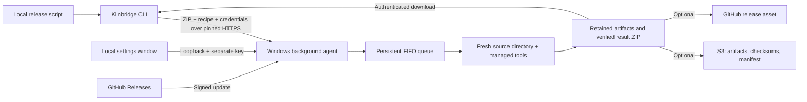

# Architecture

The single Go executable contains the HTTP server, sender CLI, WebView2 host,
HTML/CSS/JavaScript settings UI, tool provisioning scripts, S3/GitHub publishers, and updater.
Windows has no Node, Python, Rust, Go, Docker, or Git-account requirement to run it.
Flutter, Microsoft C++ Build Tools/Windows SDK, and Inno Setup remain real build-time
dependencies and are provisioned separately on first use.

`cmd/kilnbridge` dispatches UI, worker, sender, and internal update-helper modes.
`internal/agent` owns configuration, authentication, durable jobs, and local settings.
`internal/build` validates archives, provisions tools, compiles and packages, and uploads.
`internal/client` snapshots the sender's working tree and pins the worker certificate.
`internal/platform` handles DPAPI, process trees, startup, the system tray, and the native settings window.
`internal/update` verifies and installs publisher-signed releases.

One build or setup operation runs at a time. Up to four source transfers can run
concurrently, alongside up to four result downloads. Shutdown and updates wait for
transfers as well as accepted jobs; retention skips jobs with active downloads.
Up to 20 active jobs may be queued. A job
has a four-hour timeout; explicit tool setup has a two-hour timeout. Source ZIPs are
limited to 2 GiB, 100,000 entries, and 8 GiB extracted. Extraction rejects traversal,
symlinks, NTFS alternate streams, device names, and case-insensitive duplicate paths.
This prevents archive damage; executing project code is still fully trusted.

A per-data-directory OS lock prevents duplicate workers, including after a crash.
Queued jobs survive restart. An interrupted running job becomes failed; a caller must
submit it again. Finished binaries survive an upload failure, and retry only repeats
the upload. Artifacts are verified against their hashes before upload. Local jobs
finish without publication credentials. All modes retain a deterministic result ZIP
with size and SHA-256 in public job metadata. S3 uploads checksums and manifest last.
GitHub receives the ZIP under a unique job asset name; new releases stay in draft
until upload completes. See [result delivery](publication.md) for retries and retention.

The application runs for the signed-in user. Closing settings leaves the background
worker alive. The worker owns the Windows tray icon and its native message loop,
including when launched at sign-in. The icon reappears after Explorer restarts and is
removed during shutdown or update handoff. Clicking it launches the settings host;
a named per-worker object prevents duplicate hosts and restores an existing window.
The tray has no settings heartbeat, so a closed settings window still allows idle
updates. The tray's stop action uses the same idle reservation as the settings API.
Startup uses the user's Windows Run registry key. Signing out stops the
worker; this is not a service that runs before login. Sleeping or powering off the PC
makes it unavailable. The settings screen can pause new submissions or stop an idle
worker.

The remote HTTPS listener defaults to `0.0.0.0:8743`. The settings HTTP listener uses
an ephemeral `127.0.0.1` port and a separate admin token. Its initial URL fragment is
local to the settings window; it is not sent in requests or used as the remote key.
There is no public cloud coordinator, Git clone operation, or telemetry.

See [security](../SECURITY.md), [API](api.md), and [release/update details](releasing.md).
